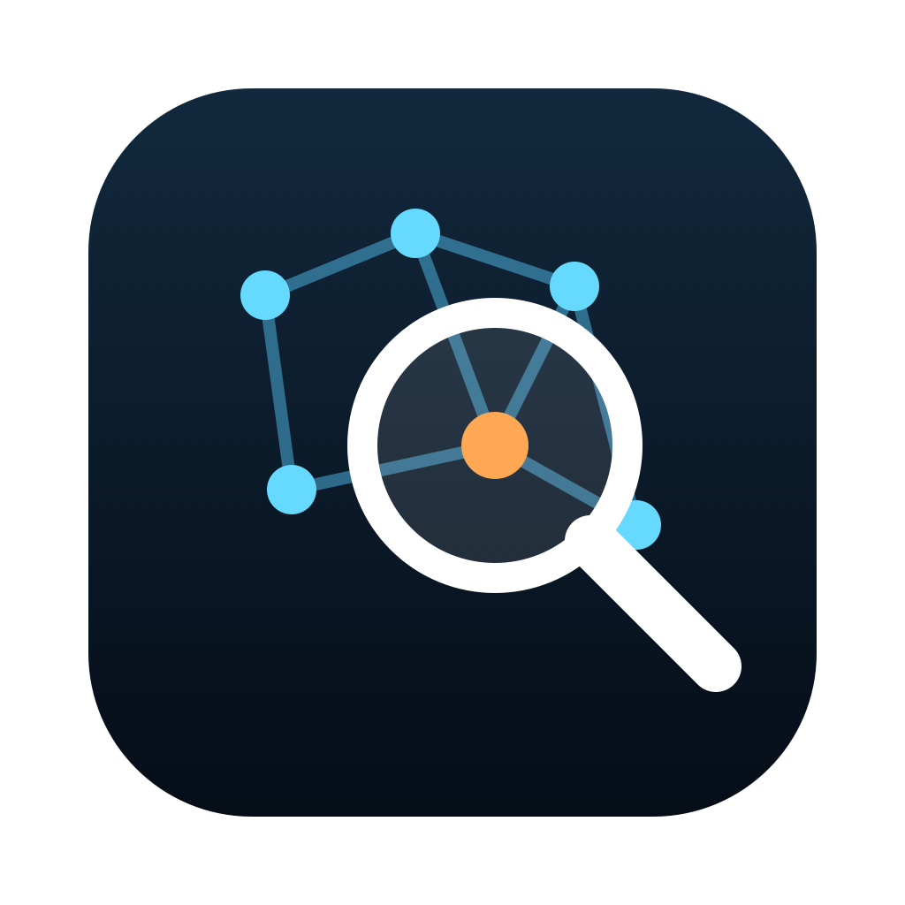
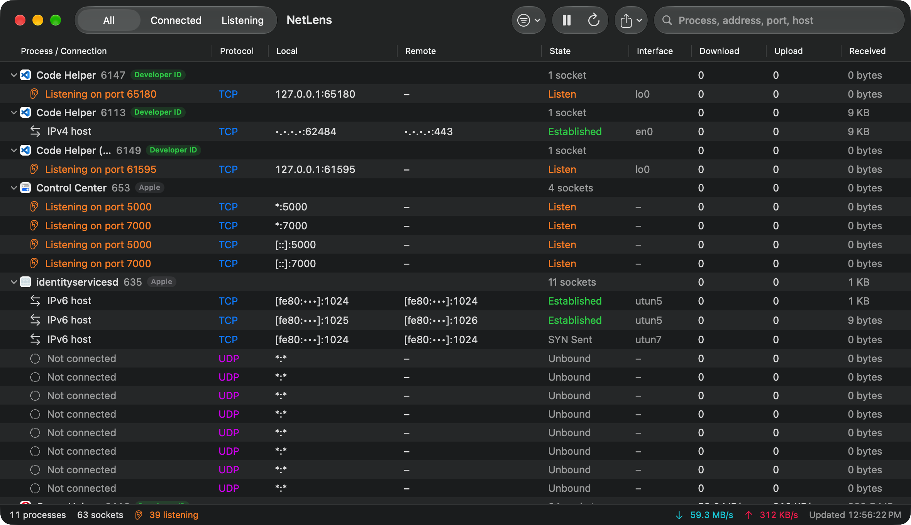

<p align="center">
  
</p>

<h1 align="center">NetLens</h1>

<p align="center">
  See every network connection on your Mac: which app opened it, where it goes, and how much data is moving right now.<br>
  A fast, native macOS network monitor.
</p>

<p align="center">
  
  
  
  
</p>

<p align="center">
  
  <br><sub>Screenshot taken with <b>Mask Addresses</b> turned on.</sub>
</p>

## Features

- **Every TCP and UDP socket, grouped by app.** Expand an app to see its connections, or collapse it to see totals.
- **Live speeds per connection.** Download and upload rates update every couple of seconds, alongside total bytes received and sent.
- **Listening ports stand out.** Programs waiting for incoming connections are highlighted, so you can spot anything that opened a port.
- **Who made each app:** every process is labelled *Apple*, *App Store*, *Developer ID*, *Ad hoc*, *Unsigned* or *Invalid* from its code signature.
- **Connection details:** local and remote address and port, TCP state, and network interface (Wi-Fi, Ethernet, VPN tunnel, loopback).
- **Instant search** across apps, addresses, ports, states and host names.
- **Quick filters:** All, Connected or Listening. TCP only or UDP only. Hide Apple processes. Hide localhost traffic.
- **Host names** through optional reverse DNS lookups (off by default, because lookups send queries to your DNS server).
- **Mask Addresses** hides every IP address and host name. Use it for screenshots, screen sharing and streaming.
- **Right-click actions:** copy the row or remote address, show the app in Finder, hide an app from the list, or quit it.
- **Export** what's on screen to JSON or CSV.
- **Pause** live updates to freeze the list while you look into something.
- **No helpers, no root, no network access of its own.** Nothing leaves your Mac, apart from optional DNS lookups.

## Install

NetLens builds with the Swift compiler from Apple's Command Line Tools, so you don't need Xcode.

```bash
xcode-select --install          # only if you don't have the Command Line Tools yet
git clone https://github.com/adamly218/NetLens.git
cd NetLens
./build.sh --install            # builds a universal app and copies it to /Applications
```

Run `./build.sh` without `--install` to build only `build/NetLens.app`.

## Keyboard shortcuts

| Shortcut | Action |
| --- | --- |
| ⌘R | Refresh now |
| ⌘P | Pause or resume live updates |
| ⌘E / ⇧⌘E | Export as JSON / CSV |
| ⌥⌘→ / ⌥⌘← | Expand / collapse all apps |
| ⌘, | Settings |

## Command line

```bash
build/NetLens.app/Contents/MacOS/NetLens --list             # table of every socket, grouped by process
build/NetLens.app/Contents/MacOS/NetLens --list --json      # the same as JSON
build/NetLens.app/Contents/MacOS/NetLens --list --libproc   # use the public libproc API only
```

Example output (with documentation addresses):

```
Safari (pid 812, Apple)
  TCP  192.0.2.10:53122        203.0.113.40:443         Established  en0
  UDP  *:5353                  *                        Listening    -
```

## How it works

NetLens has two ways to read sockets and picks the best one available.

| Source | What it gives | Notes |
| --- | --- | --- |
| **NetworkStatistics** (default) | Addresses, TCP state, interface, and bytes received and sent per socket | The framework behind `nettop`. It's private, so NetLens loads it at runtime. |
| **libproc** (fallback) | Addresses and TCP state | Public API that walks each process's file descriptors, like `lsof`. No traffic counters. |

If the NetworkStatistics framework is missing or changes in a future macOS, NetLens switches to libproc automatically. Speeds are worked out from the change in each socket's byte counters between refreshes. Code signatures are checked with the Security framework and cached per program.

### Project layout

```
Sources/
  Sockets.swift   socket models and both backends
  Monitor.swift   refresh loop, speeds, process details, reverse DNS, preferences
  Views.swift     table, toolbar, filters, export and Settings
  main.swift      SwiftUI app, menus and the command line
icon/             app icon generator (swift icon/make-icon.swift)
build.sh          build, sign and optionally install
```

## FAQ

**Why don't I see system services such as `mDNSResponder`?**
macOS only lets a normal app see sockets belonging to your own user account. Processes that run as root or as system users are hidden unless the tool runs with administrator rights. `lsof -i` without `sudo` has the same limit.

**What does "Unbound" mean?**
A UDP socket that has been created but not yet given a port or a destination. Apps often keep a few ready to use.

**Is it safe to share a screenshot?**
Turn on **Mask Addresses** first (Filters menu or Settings). It hides your local and remote IP addresses and host names, which can reveal your network and rough location. Right-click → **Hide** removes any app you'd rather not show.

**How do I remove it?**
Quit NetLens and delete `/Applications/NetLens.app`.

## License

[MIT](LICENSE) © 2026 adamly218
